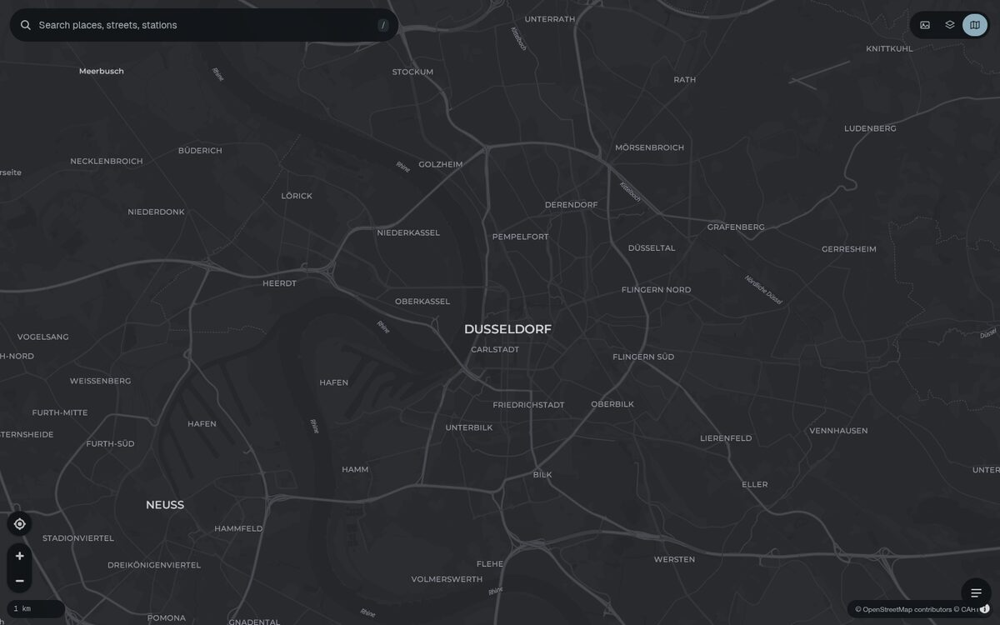
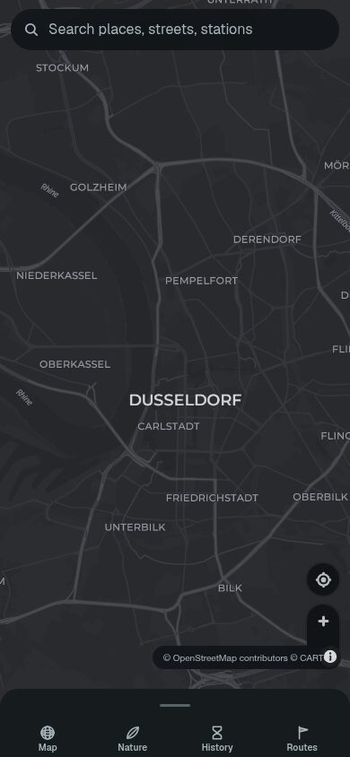

<p align="center">
  
</p>

<h1 align="center">KugelMaps</h1>

<p align="center">
  <strong>Maps, trains and the real world.</strong><br>
  Train-first public transport, hiking and walking routes, satellite basemaps and live environmental layers — running entirely in your browser.
</p>

<p align="center">
  <a href="https://github.com/bitm4ncer/kugelmaps/actions/workflows/ci.yml"></a>
  <a href="https://github.com/bitm4ncer/kugelmaps/actions/workflows/deploy.yml"></a>
  <a href="LICENSE"></a>
  
  
  
  
  
</p>

<p align="center">
  <a href="https://bitm4ncer.github.io/kugelmaps/"><strong>Open the live app →</strong></a>
</p>

KugelMaps is a client-side navigation and exploration app. It plans train, bus, tram and ferry journeys; routes hikes, bike rides and drives with elevation; and layers satellite imagery, environmental data and historical maps on top. No backend, no accounts, no tracking — settings, saved places and credentials stay in your browser.

## Screenshots

<p align="center">
  
  
</p>

## Features

### Map

| Feature | What it does |
|---|---|
| **Search** | Places, streets and stations via Photon, with detail cards for OSM places: photos, opening hours, contact, website and Wikipedia/Wikidata. |
| **Basemaps** | Three picker categories: true **Vector** styles (CARTO, OpenFreeMap, VersaTiles), **Drawn** raster cartography (basemap.de, basemap.at, swisstopo, IGN, PDOK, historical scans such as Siegfried, Dufour and État-Major) and **Image** layers (Esri, Sentinel-2, NASA GIBS, orthophotos, Vienna aerial series). Group filters and year variants keep the collection navigable; regional layers only appear while the map centre is inside their coverage. The Graphite-tinted CARTO dark style is the default. |
| **Places** | Shops, restaurants, museums, sport venues and open spaces appear as small category icons from zoom 15, Google-Maps style. Switch them off under **View → Places**. Place cards open street-level imagery and 360° panoramas from Panoramax when available. |
| **Modes** | Image, Hybrid (satellite plus transport) and Vector. |
| **Projection** | Flat Mercator or a 3D globe. |
| **Orientation** | North-up, route-up or compass heading. |
| **Live location** | Pulsing position marker with a compass heading cone on iOS and Android. |
| **Timeline** | Lock a sector and scrub every Sentinel-2 scene of the last 12 months, coloured by cloud cover. |
| **Navigation** | Turn-by-turn card with voice announcements, off-route detection, recenter and a simulation mode. |

### Routes

| Mode | What it does |
|---|---|
| **Transit** | Train, bus, tram, metro and ferry. Live departures and vehicles, transfers, via stops, arrive-by, max transfers, city filter, accessible routing, favourites, recents, share links and `.ics` export. |
| **Walk** | Hiking and trekking profiles, round trips, route candidates, elevation profile and GPX export. |
| **Bike** | Trekking, fastbike and e-bike profiles, route candidates, elevation and GPX. |
| **Car** | Fastest, shortest, avoid highways and avoid tolls, with multiple stops and alternatives. |

### Nature

- **NDVI** — vegetation index.
- **ESA WorldCover** — 11-class land cover.
- **GBIF** — species occurrences with a taxon filter.
- **Global Forest Watch** — forest loss.
- **NASA OMI / Sentinel-5P** — NO₂.
- **Natura 2000** — FFH and SPA protected areas.

### History

- **OpenHistoricalMap** — time-travel basemap with a year slider and
  period-aware political borders, settlements and roads.
- **Worldwide heritage layer** — a curated Wikidata dataset rendered as
  PMTiles clusters at world/country scale and individual sites from city
  scale, with heritage/UNESCO filters, category chips, year filtering and
  Wikipedia/Commons detail. Refreshed monthly by a data workflow; falls
  back to live OSM detail when the dataset is unavailable.

### App

- **Client-side only** — static export, no backend, no accounts, no analytics.
- **Installable PWA** — offline app shell and cached chunks.
- **Bring your own credentials** — Copernicus Data Space OAuth client for Sentinel-2 scenes, stored only in your browser.
- **Graphite UI** — cool grey surfaces, one pigeon-blue accent, no decorative borders, visible keyboard focus and reduced-motion support.
- **Responsive** — desktop drawer and mobile bottom sheet.

## Data sources

| Source | Used for |
|---|---|
| [OpenStreetMap](https://www.openstreetmap.org/copyright) | Basemap data, POIs, hiking and cycling infrastructure |
| [Esri / Maxar](https://www.esri.com/) | Satellite and hybrid reference imagery |
| [OpenFreeMap](https://openfreemap.org/) · [VersaTiles](https://versatiles.org/) | Keyless OpenStreetMap vector basemaps and styles |
| [basemap.de / BKG](https://basemap.de/) | Official German web map, topo and vector tiles |
| [basemap.at](https://basemap.at/) | Official Austrian map and orthophoto |
| [swisstopo](https://www.swisstopo.admin.ch/) | Swiss national maps, orthophotos and historical series |
| [IGN Géoplateforme](https://geoservices.ign.fr/) | French maps, orthophotos and historical series |
| [PDOK](https://www.pdok.nl/) · [Kartverket](https://www.geonorge.no/) | Dutch and Norwegian national maps |
| [National Library of Scotland](https://maps.nls.uk/) | Georeferenced historical OS maps (CC BY-NC) |
| [Sentinel-2 · Copernicus](https://dataspace.copernicus.eu/) | Cloudless annual mosaics and daily true-colour scenes |
| [NASA GIBS](https://www.earthdata.nasa.gov/engage/open-data-services-software/earthdata-developer-portal/gibs-api) | Near-real-time imagery and atmospheric layers |
| [OpenRailwayMap](https://www.openrailwaymap.org/) | Rail infrastructure overlay |
| [Transitous / MOTIS](https://transitous.org/) | Train, tram, bus and ferry routing with real-time delays where published |
| [DELFI / GTFS.de](https://www.gtfs.de/) | German nationwide scheduled and real-time transit feeds |
| [Valhalla](https://valhalla.github.io/valhalla/) | Car routing, maneuvers and road attributes |
| [BRouter](https://brouter.de/) | Hiking, cycling and car-eco routing with elevation |
| [Photon](https://photon.komoot.io/) | Address and place search |
| [Nominatim](https://nominatim.org/) | Place details, opening hours, contact tags and addresses |
| [Wikipedia · Wikidata](https://www.wikidata.org/) | Descriptions, dates, websites and social profiles |
| [Wikimedia Commons](https://commons.wikimedia.org/) | Place photos with licence links |
| [Panoramax](https://panoramax.fr/) | Open street-level imagery and 360° panoramas for Street View |
| [OpenHistoricalMap](https://www.openhistoricalmap.org/) | Historical basemap and time-filtered map data |
| [GBIF](https://www.gbif.org/) | Species occurrences |
| [Global Forest Watch](https://www.globalforestwatch.org/) | Forest loss |
| [EEA](https://www.eea.europa.eu/) | Natura 2000 protected areas |

Public demo endpoints are best-effort and may rate-limit. Routing results are informational, not a substitute for official signage.

## Stack

| Layer | Choice |
|---|---|
| Framework | Next.js 16 (static export), React 19 |
| Styling | Tailwind 4, Geist Sans/Mono |
| Map | MapLibre GL JS 5 |
| State | Zustand, persisted to localStorage |
| Tests | Vitest |
| Deploy | GitHub Pages via GitHub Actions |

## Getting started

Requires Node 22+.

```bash
npm install
npm run dev
```

Open http://localhost:3000.

| Script | Purpose |
|---|---|
| `npm run dev` | Development server |
| `npm run build` | Static export to `out/` |
| `npm run start` | Serve the production build |
| `npm run typecheck` | `tsc --noEmit` |
| `npm run lint` | ESLint |
| `npm run test` | Vitest |
| `npm run test:coverage` | Vitest with coverage |
| `npm run check:no-emoji` | Emoji guard |

### Copernicus credentials

1. Register at [dataspace.copernicus.eu](https://dataspace.copernicus.eu).
2. Dashboard → User Settings → OAuth clients → **Create**.
3. Type **Single-Page Application**, flow **Client Credentials**, web origins allow all.
4. Paste the Client ID and Secret into the app's credentials modal.

The free tier includes 30,000 Processing Units per month. Credentials never leave your browser.

## Deploy

Pushing to `main` triggers the Pages workflow. It derives the base path and canonical URL from the repository name, builds the static export and publishes `out/`.

Override with:

- `NEXT_PUBLIC_BASE_PATH` — path prefix, e.g. `/kugelmaps` (empty for a root domain).
- `NEXT_PUBLIC_SITE_URL` — canonical origin plus base path.

Enable Pages under **Settings → Pages → Source: GitHub Actions**.

## Live location

Geolocation requires a secure context: HTTPS or `localhost`. On a plain-HTTP LAN IP the browser disables it and the button shows "Location not available". On iOS, the compass heading needs an extra permission prompt from the same user tap; if denied, the dot still renders without the cone.

## Privacy

No backend, no analytics. Settings, planner state and credentials live in `localStorage`. Map tiles, routing requests and data queries go directly from your browser to the providers above.

## Status

The train planner is the focus. KugelMaps is not yet a drop-in replacement for DB Navigator, the VRR app or Google Maps — coverage and live data depend on the upstream APIs. The dark vector basemap with the Graphite tint is the default; satellite imagery is one tap away.

Next up: broader live-transit coverage and more real-time feeds.

## License

MIT — see [LICENSE](LICENSE).

<p align="center">
  <sub>Built with Next.js, MapLibre and open data.</sub>
</p>
