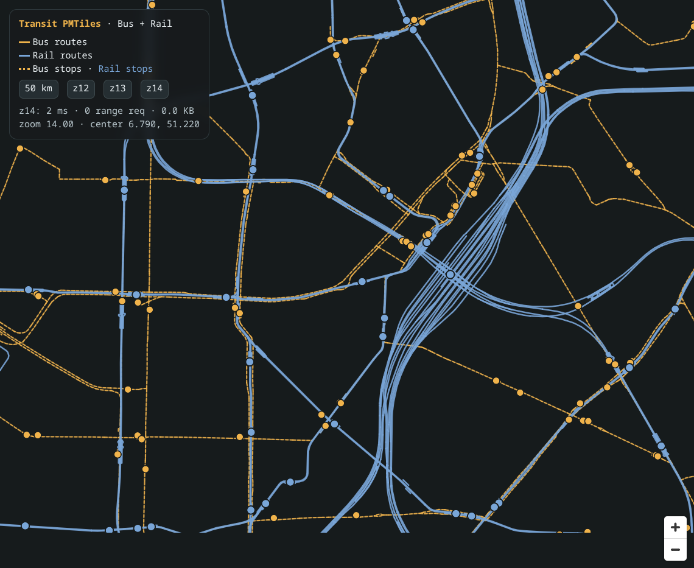
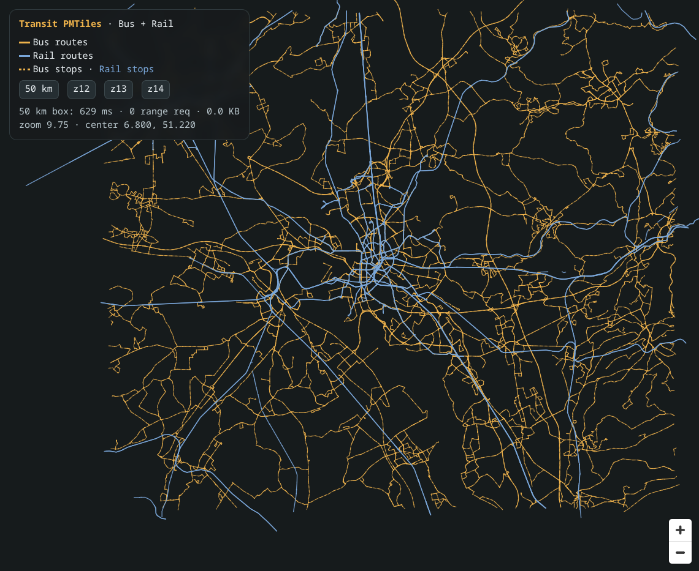

# Spike: ÖPNV-Kacheln (Bus + Rail) als PMTiles

Datum: 2026-11-20 · Status: Spike, nicht produktiv · Branch: feat/history-worldwide

## Ziel

Prüfen, ob vorberechnete Vector Tiles (PMTiles) den Overpass-Pfad für Buslinien
ersetzen können und ob derselbe Pipeline-Ansatz für Rail trägt. Erfolgskriterium:
ein 50-km-Umfeld in unter einer Sekunde und unter ~500 KB laden, ohne
Viewport-Overpass-Query, mit Bus- **und** Rail-Routen plus Haltestellen.

## Aufbau

Quelle: BBBike-Extrakt Düsseldorf (`Duesseldorf.osm.pbf`, 94 MB, Stand 2026-11-14).

Pipeline (alles lokal, reproduzierbar):

```bash
# 1. Bus-/Rail-Relationen und Haltestellen aus dem PBF extrahieren
python extract.py duesseldorf.osm.pbf .
# -> bus_routes.geojson (23.265 Wege), rail_routes.geojson (4.093 Wege)
# -> bus_stops.geojson (12.808), rail_stops.geojson (748)

# 2. Linien und Stopps zu MBTiles tiling (tippecanoe 1.36)
tippecanoe -o lines.mbtiles -Z 9 -z 14 --simplification=2 \
  --drop-densest-as-needed --extend-zooms-if-still-dropping \
  -x wayId -x relationId -x name \
  -L bus_routes:bus_routes.geojson -L rail_routes:rail_routes.geojson

tippecanoe -o stops.mbtiles -Z 12 -z 15 \
  --drop-densest-as-needed --extend-zooms-if-still-dropping -x id \
  -L bus_stops:bus_stops.geojson -L rail_stops:rail_stops.geojson

# 3. MBTiles -> PMTiles (go-pmtiles 1.31.2)
pmtiles convert lines.mbtiles lines.pmtiles
pmtiles convert stops.mbtiles stops.pmtiles
```

Artefakte:

| Datei | Größe | Zoom | Tiles | Inhalt |
|---|---:|---|---:|---|
| `lines.pmtiles` | 2,0 MB | 9–14 | 984 | `bus_routes`, `rail_routes` |
| `stops.pmtiles` | 475 KB | 12–15 | 2.477 | `bus_stops`, `rail_stops` |

Die Extraktion filtert Bus-Relationen auf `highway`-Wege und Rail-Relationen auf
`railway`-Wege; dadurch bleiben keine Plattform-/Gebäudewege in den Linien.
Pro Weg wird eine Linie erzeugt (dedupliziert); `ref`, `colour` und `route`
bleiben als Eigenschaften erhalten.

## Messung

Lokaler Range-Server (`server.js`), MapLibre 5.23, `pmtiles` 4.5.0, kalter
Browser-Cache, Düsseldorf-Zentrum. Gemessen wird bis zum ersten `idle`
(Tiles geladen und gerendert).

| Ansicht | Ladezeit | Range-Requests | Transfer |
|---|---:|---:|---:|
| z12 | **316 ms** | 14 | **135 KB** |
| z13 | **590 ms** | 18 | **82 KB** |
| z14 | **566 ms** | 8 | **33 KB** |
| 50-km-Box (z9,75) | **625 ms** | 4 | **204 KB** |

Gerenderte Features (erster Frame):

- z14: 819 Bus-Linien, 597 Rail-Linien, 85 Bushaltestellen, 39 Rail-Stopps.
- 50-km-Box: 22.541 Bus-Linien, 4.040 Rail-Linien.

Sichtprüfung: z14 zeigt dichtes Busnetz (amber, gestrichelt), Railnetz (blau)
und Haltestellen; die 50-km-Ansicht zeigt das gesamte Regionennetz ohne
Nachladen während des Panning.





## Vergleich mit dem heutigen Overpass-Pfad

Gemessen im vorherigen Audit:

- Eine 0,05°-Kachel (Düsseldorf): 0,39–0,83 MB, 1,0–1,3 s.
- 50 km: hunderte Kacheln, ~100–150 MB, mehrere Minuten; als eine Query
  25 MB+ und 10–25 s (Timeout-/Mirror-Risiko).
- Der Prefetch ist sequenziell (900 ms Pause), bricht bei `movestart` ab und
  passt mit seinen 0,05°-Kacheln nicht zum Haupt-Fetch (0,15°-Rechteck,
  `findCached` verlangt einen Eintrag, der das ganze Rechteck enthält).

PMTiles: **204 KB / 625 ms für 50 km** statt ~100 MB / Minuten. Das ist rund
**500× weniger Transfer** und **20–100× schneller**, ohne Overpass, ohne
Mirror-Rotation, ohne Prefetch-Queue. Der Grund ist strukturell: fertige,
generalisierte Tiles pro Zoomstufe, nur sichtbare Tiles, HTTP-Range/CDN-Cache,
keine räumliche Query zur Laufzeit.

## Rail

Rail nutzt in der App bereits OpenFreeMap-Vector-Tiles (`transportation`-Layer,
`poi`-Stationen) und ist damit schon tile-basiert und schnell. Die PMTiles-Pipeline
liefert zusätzlich **Routenrelationen** (Linien, `ref`, `colour`) statt nur
Gleisinfrastruktur. Empfehlung: OpenFreeMap für Gleise/Bahnhöfe behalten und
Rail-Routen als schlanken Zusatz-Layer aus derselben PMTiles-Datei laden – nicht
die funktionierende Gleisquelle ersetzen. So bleibt Rail schnell und bekommt
Linienfarben/-namen.

## Produktionsplan

1. **Client (Bus zuerst):** `pmtiles`-Protokoll registrieren, Quellen
   `transit-lines`/`transit-stops`, Layer für Bus/Rail/Stopps. Den
   Overpass-Bus-Effekt (Fetch, Prefetch, IDB-Cache) hinter einem Feature-Flag
   ersetzen; bei fehlenden Tiles Fallback auf Overpass. Stopp-Tap: `id` in den
   Tile-Properties behalten und die bestehende POI-Karte öffnen.
2. **Pipeline:** Geofabrik-PBF pro Region (Start: NRW/Deutschland), Extraktion
   mit osmium/pyosmium, Tiling mit tippecanoe oder Planetiler, PMTiles bauen.
   Wöchentlicher GitHub-Action-Lauf, versionierte Dateinamen.
3. **Hosting:** Cloudflare R2 (Range, CORS, CDN) oder GitHub Pages für kleine
   Regionen; `Cache-Control: immutable` auf versionierten Dateien.
4. **Qualität:** Routenfarben aus `colour`/Palette, Überlappungen (mehrere
   Routen pro Weg) entscheiden, Haltestellennamen, Rail-Routen, Offline-Cache
   für besuchte Tiles, Attribution (OSM ODbL).
5. **Rollout:** Feature-Flag, Deutschland zuerst, dann Europa/weltweit pro
   Region; Overpass bleibt nur Fallback.

## Offene Punkte / Risiken

- Der Spike-Extrakt deckt ~50 × 40 km ab, nicht in alle Richtungen volle 50 km.
  Für die Produktion größeren Extrakt (NRW/Deutschland) bauen.
- Messung lief gegen einen lokalen Server; R2/CDN addiert Latenz, die
  Range-Requests sind aber klein (204 KB für 50 km).
- `id` wurde aus Platzgründen aus den Stop-Tiles entfernt; für Taps wieder
  aufnehmen.
- Routen-`ref`/`colour` sind vorhanden, aber noch nicht datengetrieben gefärbt.
- Rail: Entscheidung nötig, ob OpenFreeMap-Gleise + PMTiles-Routen parallel
  laufen (empfohlen) oder ob die Gleise komplett aus PMTiles kommen.
- Datenaktualität: wöchentlicher Build; OSM-Attribution ist Pflicht.

## Fazit

Der Spike bestätigt die Architektur: **PMTiles ist für Bus die richtige Quelle,
für Rail eine sinnvolle Ergänzung.** 50 km ÖPNV-Netz in ~0,6 s und ~200 KB sind
mit Overpass auf dem Handy nicht erreichbar. Nächster Schritt ist die
Client-Integration hinter einem Flag plus die Deutschland-Pipeline.
